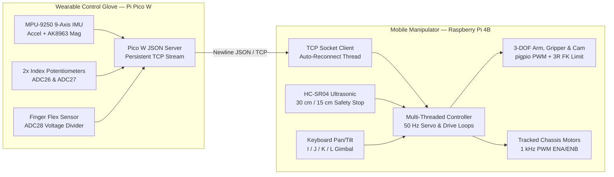

# Wearable Glove Teleoperation & 3-DOF Mobile Manipulator

A dual-microcontroller telerobotics system pairing a **Raspberry Pi Pico W** wearable sensor glove with a **Raspberry Pi 4B** tracked mobile manipulator. The architecture streams real-time 9-axis IMU orientation, finger flex, and dual potentiometer joint telemetry over a persistent TCP socket, combining tilt-compensated compass navigation, multi-threaded 50 Hz `pigpio` servo actuation, ultrasonic obstacle gating, and a 3R planar forward-kinematics collision limiter.

Photos and Videos available here: https://github.com/UMIengineer/telerobotics-glove-controlled-mobile-robot-arm/releases/tag/Telerobotics

## System Architecture & Control Flow



## Key Engineering Highlights & Results

| Subsystem | Metric / Specification | Engineering Details |
| :--- | :--- | :--- |
| **Network & Control Loop** | **50 Hz Multi-Threaded Control** | Persistent newline-delimited JSON over TCP (`10.42.0.178:5000`) with isolated socket receive, servo actuation, and drive loops synchronized via `threading.Lock` |
| **Kinematics Safety Interlock** | **3R Planar FK Height Cutoff** | Computes real-time end-effector vertical height $y_{ke}$ across links ($l_1=5\text{ cm}, l_2=9.5\text{ cm}, l_3=14\text{ cm}, \theta_1=45^\circ$) to block downward commands before chassis/ground strikes |
| **IMU & Heading Fusion** | **100-Sample Calibrated Compass** | On-boot AK8963 magnetometer calibration with roll/pitch tilt compensation, exponential low-pass filtering ($\alpha = 0.5$), and 8-sector azimuth classification (`N`–`NW`) |
| **Actuation Stability** | **EMA + Deadband `pigpio` PWM** | Hardware-timed `pigpio` PWM with exponential moving average smoothing ($\alpha = 0.1$) and `100 µs` pulse-width deadband to eliminate potentiometer servo jitter |
| **Collision Avoidance** | **Directional Ultrasonic Gating** | HC-SR04 proximity checks enforce `30 cm` forward clearance and `15 cm` lateral turn clearance alongside compass-gated accelerometer tilt driving (`S`, `E`, `W`) |

## Repository Structure

### Raspberry Pi Pico W (Wearable Glove Firmware — MicroPython)
* `server_post_pico_data.py` — Main MicroPython entry point connecting the Pico W to the static WLAN (`10.42.0.178:5000`), polling all glove sensors, and streaming `\n`-delimited JSON telemetry packets with `BOOTSEL` interrupt and LED status feedback.
* `accelerometer.py` — Initializes the MPU-9250 over I²C (`0x68`) and samples 3-axis linear acceleration (`ax, ay, az`).
* `magnometer_directional_control.py` — Calibrates the AK8963 magnetometer (`100` samples), applies roll/pitch tilt compensation and low-pass filtering, and maps azimuth (`0–360°`) to 8 compass headings.
* `flex_sensor_testing.py` — Configures the 16-bit ADC channel (`GP28`) for finger flex voltage acquisition.
* `potentiometer_voltage_reading.py` — Samples dual 16-bit ADC joint potentiometers (`GP27`, `GP26`) for 2-DOF arm articulation.

### Raspberry Pi 4B (Mobile Manipulator & Control — Python)
* `glove_servomotor_integration.py` — Multi-threaded main controller running concurrent TCP telemetry ingestion, `50 Hz` servo updates, differential-drive H-bridge motor control, ultrasonic distance gating, and keyboard listener shutdown (`ESC`).
* `client_get_pico_data.py` — Buffered TCP socket client (`makefile('r')`) with automatic timeout handling and reconnection to the Pico W telemetry stream.
* `glove_motor_integration.py` — Hardware-timed `pigpio` PWM controller implementing exponential smoothing, deadband filtering, 3R forward-kinematics workspace limits, flex/accelerometer actuation, and `I/J/K/L` camera gimbal control.

## Hardware Pinout Layout

| Controller | Component | Pin(s) | Protocol / Electrical Notes |
| :--- | :--- | :--- | :--- |
| **Raspberry Pi 4B** | Chassis Motor Enable (`ENA`, `ENB`) | `GPIO 13`, `GPIO 20` (BCM) | `1 kHz` PWM speed control (`50%` duty cycle) |
| **Raspberry Pi 4B** | Chassis Motor Direction (`IN1–IN4`) | `GPIO 19, 16, 21, 26` (BCM) | H-bridge directional logic for forward, reverse, and differential turns |
| **Raspberry Pi 4B** | HC-SR04 Ultrasonic Sensor | `GPIO 17` (TRIG), `GPIO 4` (ECHO) | Proximity interlock (`30 cm` forward / `15 cm` turn thresholds) |
| **Raspberry Pi 4B** | Arm, Gripper & Wrist Servos | `GPIO 5, 6, 7, 8` (BCM) | Hardware PWM via `pigpio` (`Pot1`, `Pot2`, `Accel`, `Flex` channels) |
| **Raspberry Pi 4B** | Camera Pan/Tilt Gimbal Servos | `GPIO 9`, `GPIO 10` (BCM) | `500–2500 µs` hardware PWM (`1500 µs` center, `I/J/K/L` step control) |
| **Pi Pico W** | MPU-9250 9-Axis IMU (`0x68`) | `GP0` (SDA), `GP1` (SCL) | `I2C0` bus reading 3-axis accelerometer and AK8963 magnetometer |
| **Pi Pico W** | Dual Joint Potentiometers | `GP27` (ADC1), `GP26` (ADC0) | 16-bit analog joint angle dividers (`40 kΩ–65 kΩ` operating range) |
| **Pi Pico W** | Finger Flex Sensor | `GP28` (ADC2) | 16-bit analog voltage divider (`1.3 V–2.1 V` active range) |

## Running the System

```bash
# 1. Power on the Raspberry Pi Pico W running server_post_pico_data.py
#    (connects to hotspot SSID 'group_5_assignment_2' at 10.42.0.178:5000)

# 2. Start the pigpio daemon on the Raspberry Pi 4B
sudo pigpiod

# 3. Launch the multi-threaded glove & mobile manipulator controller
python3 glove_servomotor_integration.py
```
