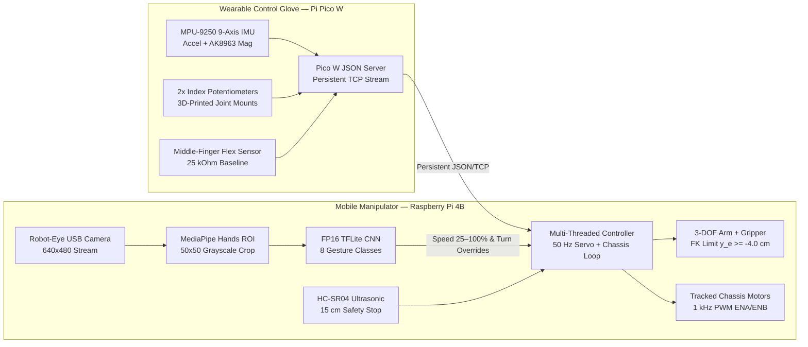

# Wearable Glove Teleoperation & Vision-Guided 3-DOF Mobile Manipulator

A dual-microcontroller telerobotics system pairing a **Raspberry Pi Pico W** wearable sensor glove with a **Raspberry Pi 4B** tracked mobile manipulator. The architecture fuses real-time IMU tilt, finger flex and potentiometer joint tracking, 3R forward-kinematics collision safety interlocks, and an **FP16 TensorFlow Lite CNN (98.75% test accuracy)** for low-latency hybrid gesture and wearable control.

## System Architecture & Control Flow



## Key Engineering Highlights & Results

| Subsystem | Metric / Specification | Engineering Details |
| :--- | :--- | :--- |
| **Gesture CNN Accuracy** | **98.75% Test Accuracy** (`0.0334` loss) | 8-class TensorFlow Sequential CNN (`1,204,104` params) trained on 850 images/class with MediaPipe hand-landmark ROI cropping (`99.64%` peak val accuracy) |
| **Edge Inference Optimization** | **FP16 TensorFlow Lite** | Quantized from 32-bit Keras to 16-bit `.tflite` for real-time CPU inference on Raspberry Pi 4B with confidence gating (`>80%` turns, `>75%` speed, `50%` fallback) |
| **Network & Control Latency** | **~1.4 s Latency Reduction** | Replaced per-loop TCP handshakes with a persistent newline-delimited JSON socket stream and isolated network / 50 Hz servo threads (`threading.Lock`) |
| **Kinematics Safety Interlock** | **$y_e \ge -4.0\text{ cm}$ Hard Cutoff** | Real-time 3R planar forward kinematics ($l_1=5\text{ cm}, l_2=9.5\text{ cm}, l_3=14\text{ cm}, \theta_1=45^\circ$) prevents end-effector ground strikes (2 cm chassis clearance) |
| **Sensor & Actuation Stability** | **Tilt-Compensated EMA & `pigpio`** | 100-sample AK8963 magnetometer calibration with low-pass filtering ($\alpha = 0.8$) and `pigpio` hardware PWM to eliminate servo jitter |

## Repository Structure

* `glove_motor_integration.py` — Multi-threaded Raspberry Pi 4B main controller fusing persistent TCP glove telemetry, 50 Hz robotic arm/gripper actuation, and TFLite gesture speed/steering overrides.
* `hand_gesture_motor_control.py` — Real-time vision pipeline (`RobotVision`) using MediaPipe Hands landmark localization and FP16 TFLite inference across 8 command classes (`sp1`–`sp4`, `left`, `right`, `stop`, `background`).
* `pico_magnetometer.py` — MicroPython firmware for Raspberry Pi Pico W handling I²C MPU-9250/AK8963 calibration, exponential low-pass filtering, and 8-sector compass heading classification.
* `train_gesture_cnn.py` — TensorFlow/Keras training pipeline with `EarlyStopping`, normalized confusion matrix generation, and FP16 `.tflite` edge model export.

## Hardware Pinout Layout

| Controller | Component | Pin(s) | Protocol / Electrical Notes |
| :--- | :--- | :--- | :--- |
| **Raspberry Pi 4B** | Chassis Motor Enable (`ENA`, `ENB`) | `GPIO 13`, `GPIO 20` (BCM) | 1 kHz PWM speed control (`25%`, `50%`, `75%`, `100%`) via `PWR.A53` driver |
| **Raspberry Pi 4B** | Chassis Motor Direction (`IN1–IN4`) | `GPIO 19, 16, 21, 26` (BCM) | H-bridge directional logic for forward, reverse, and differential turns |
| **Raspberry Pi 4B** | HC-SR04 Ultrasonic Sensor | `GPIO 17` (TRIG), `GPIO 4` (ECHO) | Undercarriage proximity mount enforcing 15 cm collision-stop threshold |
| **Raspberry Pi 4B** | 3-DOF Arm & Gripper Servos | `PWR.A53` Servo Headers | Hardware-timed PWM via `pigpio` daemon (`l1=5 cm`, `l2=9.5 cm`, `l3=14 cm`) |
| **Raspberry Pi 4B** | Robot-Eye USB Camera | USB 2.0/3.0 | 640×480 live capture downsampled to 50×50 grayscale ROI |
| **Pi Pico W** | MPU-9250 9-Axis IMU (`0x68`) | `GP0` (SDA), `GP1` (SCL) | I²C0 bus reading 3-axis accelerometer and AK8963 magnetometer |
| **Pi Pico W** | Dual Index Potentiometers & Flex Sensor | Analog ADC Inputs | Voltage dividers (`25 kΩ` baseline flex sensor) streamed over Wi-Fi TCP |

## Running the System

```bash
# 1. Start the pigpio daemon on the Raspberry Pi 4B
sudo pigpiod

# 2. Run the multi-threaded vision & glove teleoperation controller
python3 glove_motor_integration.py
```
````[cite: 158, 160, 161, 162, 164, 165, 166, 169, 170, 171, 180, 182, 183, 184, 185, 189, 191, 192, 193, 194]
